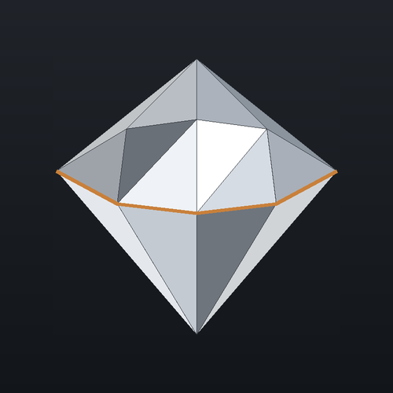

<h1 align="center">AutoSculpt 3D</h1>

<i>Dal sogno alla realtà</i> <i>From dream to reality</i>

---

## Download

| | |
|---|---|
| **Mac** (chip Apple e Intel) | [**Scarica AutoSculpt 3D per Mac**](https://github.com/SculptWorksLTD/AutoSculpt3D/raw/main/download/AutoSculpt3D.pkg) |
| **Windows 10/11** | [**Scarica AutoSculpt 3D per Windows**](https://github.com/SculptWorksLTD/AutoSculpt3D/raw/main/download/AutoSculpt3D-Setup.exe) |

Dopo l'installazione il programma si aggiorna da solo all'ultima versione: al primo avvio lascialo collegato a internet e riavvialo quando lo chiede.
*After installing, the program updates itself to the latest version: keep it online at the first start and restart it when asked.*

## Cos'è

AutoSculpt 3D trasforma un'idea in una **scultura in lamiera sfaccettata**, pronta da tagliare al laser e saldare a TIG.
Si parte da un modello 3D, da una foto o anche solo da una descrizione: il programma pensa a tutto il resto.

Dalla stessa finestra si fa anche la **carpenteria** di tutti i giorni: cancelli, inferriate, pensiline e mobili su misura,
con distinta di taglio, parti in lamiera per il laser e preventivo.

Tutti i calcoli (sfaccettatura, sviluppo dei pezzi, annidamento, file per il laser) sono fatti da **SculptEngine**, il motore proprietario di AutoSculpt 3D.

## Cosa fa

- **Da una descrizione** – scrivi o detta cosa vuoi scolpire: il programma disegna le immagini, tu scegli la migliore e lui costruisce il modello 3D.
- **Da una foto** – una o più foto del soggetto diventano un modello 3D, sul computer o con i servizi online.
- **Modelli pronti** – apre i file 3D più comuni e cerca modelli gratuiti nelle principali librerie.
- **Sfaccettatura** – riduce il modello al numero di facce che vuoi, con facce regolari e i dettagli dove servono; anche simmetrico.
- **Pezzi e pieghe** – divide la scultura in pezzi numerati, con pieghe, asole e linguette; scarta i pezzi troppo piccoli.
- **Taglio laser** – dispone i pezzi sulle lamiere e prepara i file DXF per il taglio.
- **Mockup** – mostra la scultura finita nel materiale scelto (acciaio inox, ferro, ottone, rame, alluminio), con sfondi da studio, paesaggi, la tua foto o carta millimetrata, vista da tutti i lati.
- **Carpenteria** – cancelli (a una o due ante, scorrevoli), inferriate, pensiline, tavoli, panche e scaffali su misura: distinta di taglio dei profili, barre da ordinare, parti in lamiera in DXF, preventivo e scheda di lavorazione in PDF.
- **Preventivo e montaggio** – calcola materiale e costi e prepara la guida di montaggio passo per passo.
- **Progetti** – salvataggio automatico, file di progetto propri (.as3d) con anteprima, aggiornamenti automatici.
- **7 lingue** – italiano, inglese, tedesco, francese, spagnolo, portoghese e giapponese.

## Requisiti

- **Mac** con macOS recente (chip Apple consigliato) oppure **Windows 10/11**.
- Per creare immagini e modelli 3D sul computer: almeno 16 GB di memoria e un chip Apple o una scheda NVIDIA. In alternativa si usano i servizi online, senza scaricare nulla.

---

## What it is

AutoSculpt 3D turns an idea into a **faceted sheet-metal sculpture**, ready for laser cutting and TIG welding.
Start from a 3D model, a photo or just a description: the program takes care of the rest.

The same window also does everyday **metalwork**: gates, window grilles, canopies and furniture made to measure,
with the cutting list, the sheet parts for the laser and the quote.

All the calculations (faceting, unfolding, nesting, laser files) are made by **SculptEngine**, the proprietary engine of AutoSculpt 3D.

**Main features:** pictures and 3D models from a description or from photos · faceting with the number of faces you choose,
also symmetric · numbered pieces with bends, slots and tabs · nesting on the sheets and DXF for the laser · realistic mockup
in the chosen metal · quote and step-by-step assembly guide · automatic saving and updates · 7 languages.

**Requirements:** a Mac with a recent macOS or Windows 10/11; for pictures and 3D models on the computer, 16 GB of memory and
an Apple chip or an NVIDIA card (otherwise the online services work without any download).

---

AutoSculpt 3D e SculptEngine · © 2026 Enrico Migliorati. Tutti i diritti riservati / All rights reserved. Software proprietario: copia, distribuzione e
modifica non consentite senza autorizzazione scritta del titolare. Questo repository contiene solo gli installer e il canale degli
aggiornamenti del programma.
